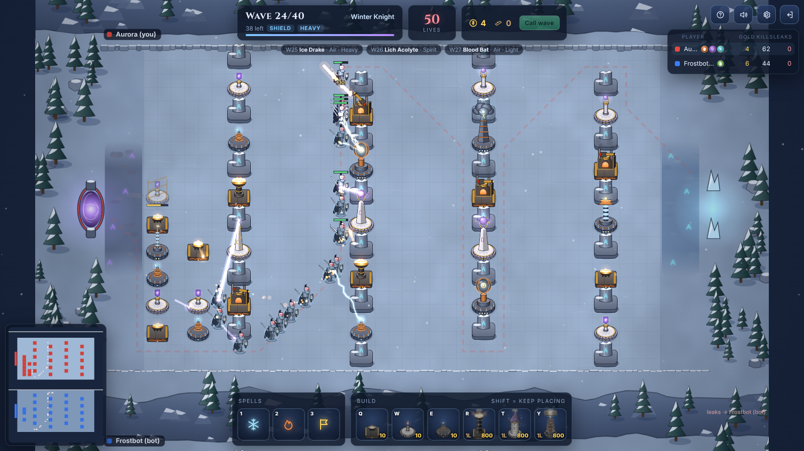
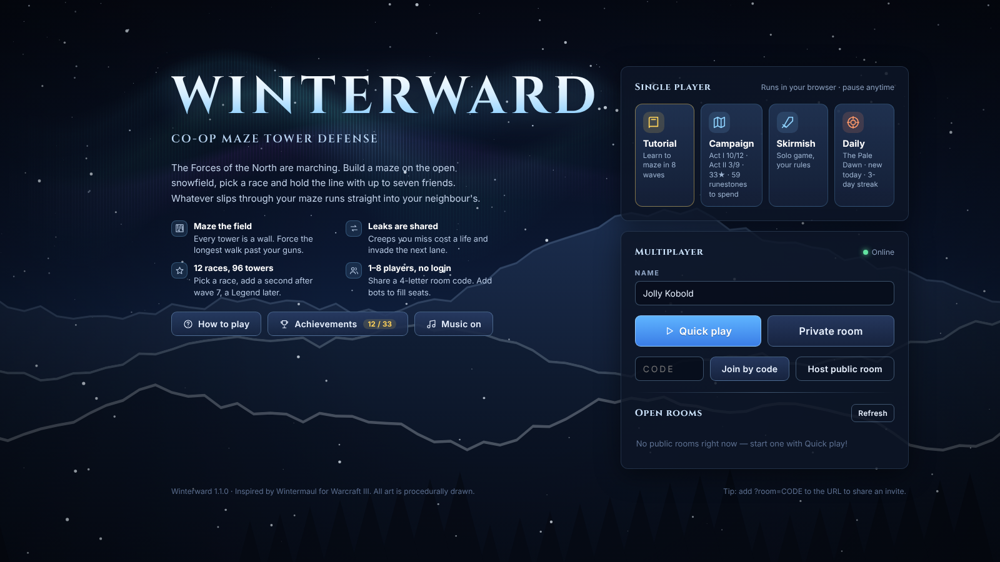
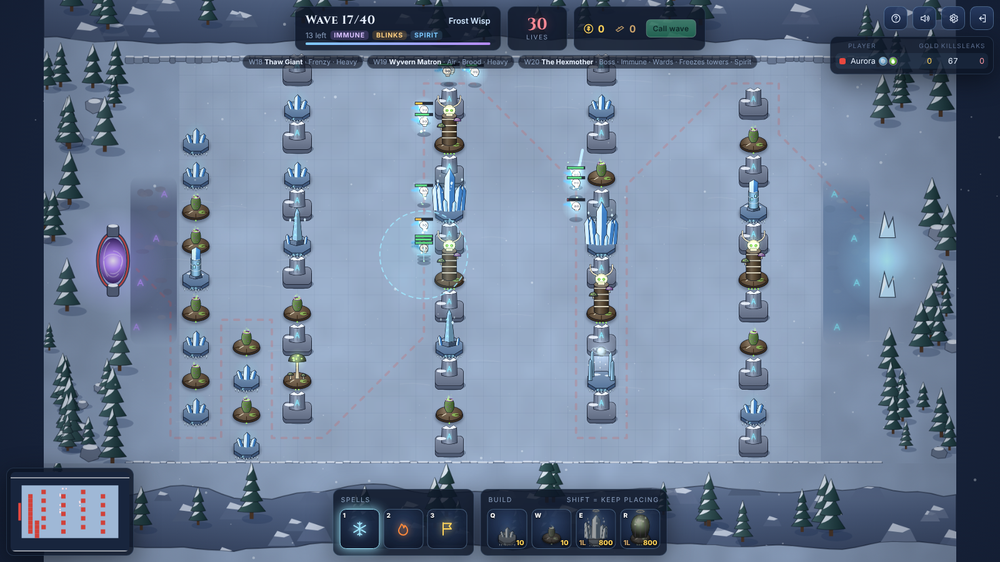
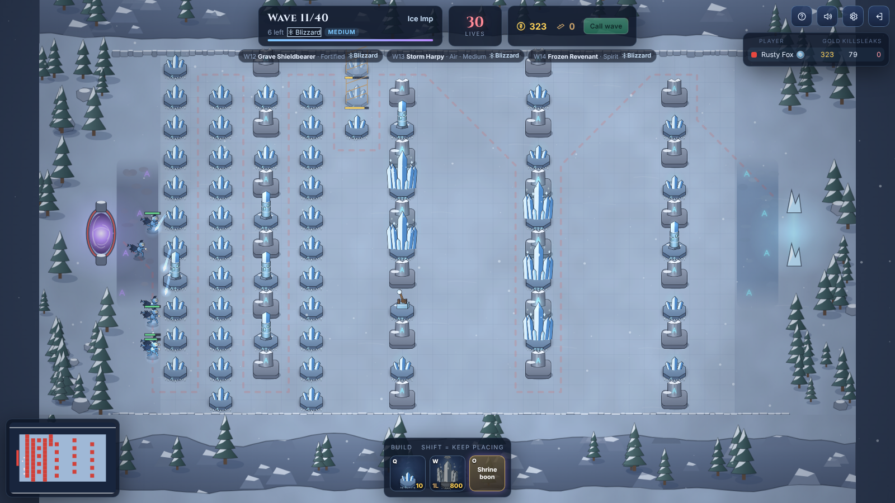
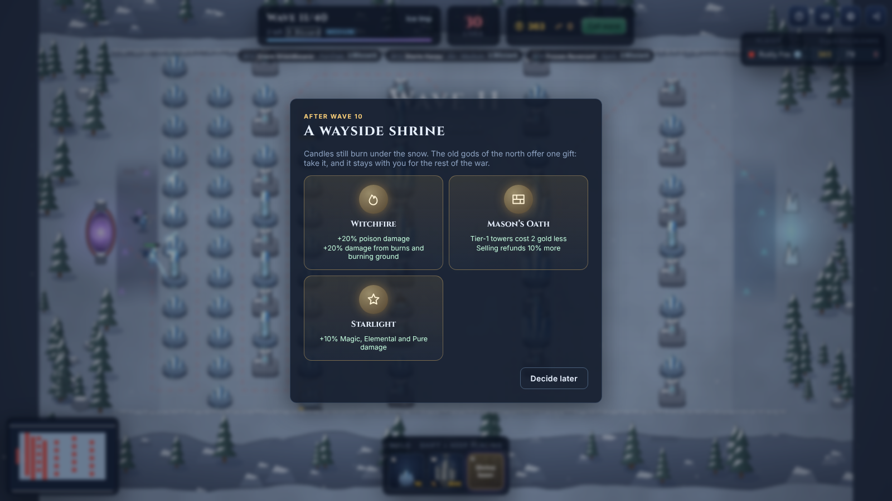
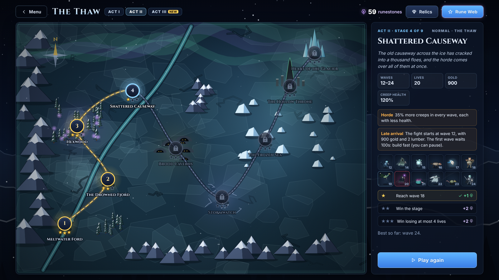
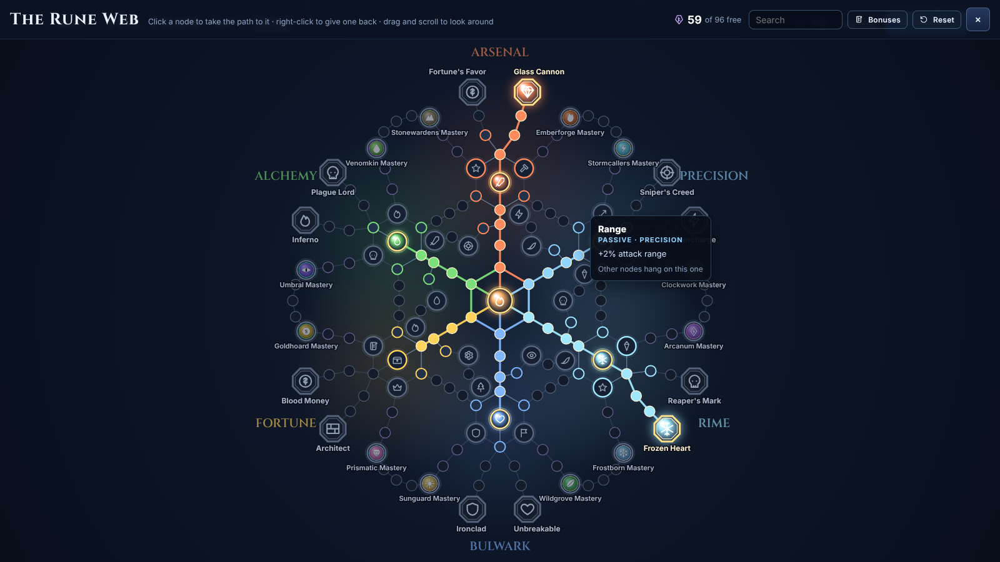
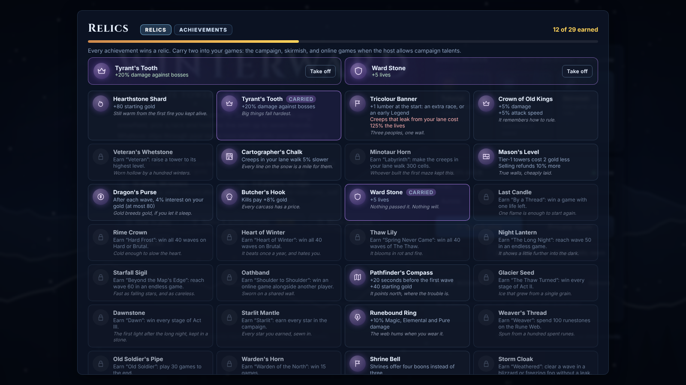
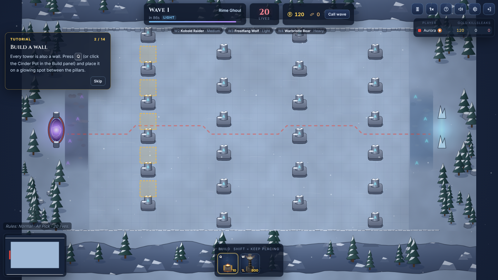
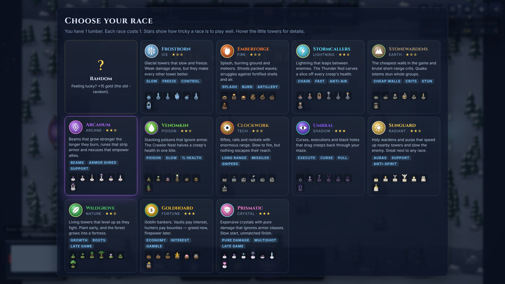

# ❄ Winterward

**A co-op maze tower defense for the browser, in the spirit of the Warcraft III map *Wintermaul*.**
Up to 8 players, no login, 12 races and 96 towers, two sets of 40 waves and their final bosses. Build a
maze on an open snowfield: whatever slips through your maze runs straight into your neighbour's. Alone?
Play the tutorial, a 29-stage campaign in three acts with a passive tree in the spirit of Path of Exile, or
a quick skirmish, all running right in your browser, on a computer or a phone. Every wave has its weather,
every fifth a shrine offers you a boon, and every achievement wins a relic to carry into battle.

Version **3.1.0** · [Changelog](CHANGELOG.md)



## Play it locally

Requirements: **Node.js 20+** (22 recommended).

```bash
git clone https://github.com/StefanJonsson96/wintermaul.git
cd wintermaul
npm install
npm run play          # builds everything and starts the server
```

Open **http://localhost:8787**. For multiplayer press **Quick play** or create a private room, and add
bots if you like. Friends on the same network open `http://<your-ip>:8787` and join with your 4-letter
room code or the invite link from the lobby.

Development mode with hot reload (client on port 5173, proxied to the server on 8787):

```bash
npm run dev           # then open http://localhost:5173
```

## Game modes



| Mode | What it is |
|---|---|
| **Tutorial** | One click from the menu. An 8-wave game where a coach explains one idea at a time (walls, zig-zags, calling waves, upgrades, air, leaks, lumber) and waits for you to try it. |
| **Campaign** | Three acts, *The Long Winter*, *The Thaw* and *The Long Night*: 29 stages on three painted maps, each with its own twist, three stars to earn and runestones for the Rune Web. |
| **Skirmish** | A solo game with your rules: difficulty, Classic waves or The Thaw, weather and omens, forty waves or endless. |
| **Multiplayer** | 1–8 players in a room, with bots to fill seats. The first player picks the rules, like Red in the original. |

Single-player games are simulated in your browser: press **P** to pause (they also pause when you switch
tabs) and **F** to play at 2× or 3× speed. They save as you play: close the tab, come back later and press
**Continue** on the menu.

### The Thaw



The rules dialog offers a second set of forty waves. What slept under the glacier fights back: **burrowers**
dig in and can't be hit, **blinkers** jump ahead along the path, **brood mothers** drop hatchlings,
**wardens** shield the creeps around them, **war drummers** speed their wave up, **frenzied** brutes run
faster as they bleed, and **hexers** freeze your towers solid for a few seconds. Some waves mix two kinds
of creep. The wave preview names every trick a wave has.

### Weather and omens



Every wave has a **forecast**, shown in the wave bar and the preview of the next waves. **Blizzards**
shorten every tower's reach and pile **snowdrifts** across the creeps' path, rerouting your maze until the
wave ends. **Auroras** feed Magic, Elemental and Pure damage, **freezing fog** makes slows linger but towers
sluggish, a **warm wind** speeds the creeps and melts rubble, and under a **blood moon** creeps are tougher
and richer, and the last of each wave is a **moon-touched elite** worth eight times the gold. Plan the maze
and the next race around what is coming.

After every fifth wave a **wayside shrine** offers you three of twenty-two **boons**. Some bend the rules
(*Snow Angel's Mercy* forgives the first leak of each wave, *Undertow* weakens what leaks out of your lane,
*Avalanche* buries the rest of the wave when one leaks, *Clean Sweep* pays for a wave without a leak),
some are plain strength (*The Smith's Ember*, *Cold Iron*), and some have a price (*Blood Price*). Everyone
sees everyone's boons in the scoreboard. Take one and it stays with you for
the rest of the game, so no two games build the same way. Both can be switched off in the rules dialog.



### On a phone or tablet

Everything single-player works by touch. Tap a tower in the Build panel, then tap the map to build (keep
your finger down to aim before you let go); you stay in build mode until you tap **Done**. Drag to move the
camera, pinch to zoom, tap a tower to select it, double-tap to select every tower of that kind, and press and
hold a button to see what it does. Turn the phone sideways: the lane is wide.

`npm run build:artifact` packs the single-player game into one stand-alone page
(`dist/artifact/winterward.html`) that can be hosted anywhere static, for example as a claude.ai artifact.
Multiplayer still needs the server.

### The campaign



Every stage is a real game with its own rules. Some start at wave 1; others throw you into the war at
wave 15 or 30 with a war chest and a long first countdown to build in. Stages can limit the races you
may pick or add mutators: swift creeps, regeneration, extra armor, bigger waves. Each stage has three
stars:

1. **Reach** a given wave,
2. **Win** the stage,
3. win **losing at most a few lives**.

Stars pay **runestones**. Win a stage to open the next; win *The Drowned Mill* to open **Act II, The
Thaw**, nine stages on the glacier against the creeps that fight back, and *Hexwood* to open **Act III,
The Long Night**: eight stages under the polar night where the weather is the enemy (a pass that is one
long blizzard, a vale of endless aurora, a night of blood moons, a fog sea), the shrines come more often,
or the land gives you only sixty towers. Win *The Iron Pass* to open **The Endless Frontier**, which pays a
runestone every 5 waves past wave 20 the first time you get there. All three acts together pay for the
whole Rune Web.

### The Rune Web



Runestones are spent on **the Rune Web**, a passive tree of 193 nodes in the spirit of Path of Exile. You
start at the Hearth in the middle and take nodes next to what you have: click a node to take the whole
path to it. Six regions (Arsenal, Precision, Rime, Bulwark, Fortune, Alchemy) each have small nodes,
named **notables** and two **keystones** that change how you play, with a drawback:

| Region | Keystones |
|---|---|
| **Arsenal** | *Glass Cannon*: +30% damage, but leaks from your lane cost double lives. *Fortune's Favor*: double-damage hits, but the other hits are weaker. |
| **Precision** | *Overcharge*: much faster attacks, shorter range. *Sniper's Creed*: long range, slower attacks. |
| **Rime** | *Frozen Heart*: stronger, longer slows for less damage. *Reaper's Mark*: your hits finish off creeps below 6% health, but you are weaker against bosses. |
| **Bulwark** | *Ironclad*: +10 lives, slower attacks. *Unbreakable*: a much bigger Second Wind, less damage. |
| **Fortune** | *Blood Money*: kills pay half again, the wave bonus half. *Architect*: cheap walls that build at once, dearer upgrades. |
| **Alchemy** | *Plague Lord*: far stronger poison, weaker everything else. *Inferno*: stronger fire and wider splash, weaker direct hits. |

Around the rim sits a mastery for each of the 12 races. Search finds nodes by name or effect, Bonuses sums
up what you have taken, and giving a node back is free (right-click it, or *Give back* on a phone) as
long as nothing else hangs on it. In multiplayer the host can switch **Campaign talents** on in the lobby (off
by default), and everyone brings the passives they took.

### Relics and achievements



Twenty-nine achievements, from killing your first boss to a 300-cell maze, six boons in one game, every
star of the campaign or a win on Brutal. **Every achievement wins a relic**: a keepsake with a small
bonus, sometimes with a price (*Tyrant's Tooth*: +20% damage against bosses; *Heart of Winter*: +15%
damage, but leaks cost double; *Shrine Bell*: shrines offer four boons). Carry one into your games, two
once you have twelve achievements: in the campaign, in skirmish, and online when the host allows campaign
talents. Games where developer commands were used earn nothing.

### Moving your progress

**Move progress** on the menu shows your whole save (campaign, Rune Web, relics, achievements and the game
in progress) as one code. Copy it, or save it as a file, and load it on your other device: it shows both
saves side by side before replacing anything, and keeps the achievements of both. As a claude.ai
artifact, progress also follows you between devices on its own.

## How to play



1. **Pick the rules.** When the game starts, the first player has 30 seconds to choose the difficulty,
   race mode and whether the game is endless.
2. **Pick a race** with your lumber (or go *Random* for bonus gold; `-random` works in chat too).
3. **Maze.** Creeps walk from the portal on the left to the gate on the right using the shortest path.
   Every tower is also a wall. Plug the gaps between the ancient pillars to bend the path cheaply, then
   build full walls to make a long serpentine. You can never fully block the path.
4. **Keep building** with every bounty during the first waves, then **upgrade in place** (two branches
   per tower, tier 1 → 4) and save for big towers.
5. **Leaks are shared.** A creep that reaches your gate costs the team lives and runs into the next
   player's lane with the health it has left. Kill your neighbour's leaks for their bounty, or help them
   with a gold gift (right-click them in the scoreboard).
6. You get more lumber after waves 7 and 20: a second race, a third, or a **Legend** tower. Survive 40
   waves. The last is led by the Winter Tyrant, and if he escapes the north falls.

| Control | Action |
|---|---|
| Left click | Select a tower / place a tower (hold **Shift** to keep placing) |
| Drag / double-click | Box-select / select all towers of that type on screen |
| Q W E R T Y | Build buttons, or upgrade branches when towers are selected |
| L | Choose a new race (when you have lumber) |
| X / Delete | Sell selected towers |
| Right click / Esc | Cancel placement / deselect |
| Wheel, arrows, right- or middle-drag | Zoom and move the camera |
| Space | Jump back to your lane |
| G | Ready / call the next wave early |
| O | Open the shrine's offer (after every fifth wave) |
| P / F | Pause / game speed (single player) |
| Alt + click | Ping the map for your team |
| Enter | Chat (`-random`, `-ready`, `-help`) |



## What's inside

- **Research-based design.** The rules come from the original map's own script and data (lives, level
  bonus, lumber, leak flow, anti-block, the difficulty dialog…) plus Wintermaul One's lane rotation. See
  [docs/RESEARCH.md](docs/RESEARCH.md) and [docs/DESIGN.md](docs/DESIGN.md).
- **One simulation everywhere.** The same deterministic TypeScript simulation runs on the server
  (multiplayer), in the browser (single player), in the bots and in the headless balance scripts.
- **Authoritative multiplayer**: Node + WebSocket server simulating at 20 Hz, 10 Hz snapshots,
  client-side interpolation, reconnect-by-token, spectators, lobby with public and private rooms.
- **All art is procedural**: canvas drawing code for the towers (a building style per race), the
  creature shapes, the terrain, the emblems and the three campaign maps. All sound is synthesized with
  WebAudio, music included: pads, bells and wind, with drums when a wave is on and a darker turn for
  bosses. No third-party assets.
- **Saves are replays.** A single-player game is saved as its seed and the commands you gave; Continue
  plays them back on the same seed and lands on the same state.

```
src/shared/          rules and data (races, towers, waves, campaign, talents), grid, protocol
src/shared/sim/      the simulation: game (state, commands, waves), horde (creeps), combat (towers),
                     talent bonuses, bots, and the real-time runner
src/server/          HTTP + WebSocket server, rooms and lobby
src/client/          menu and lobby, local single-player games and saves, music
src/client/modes/    tutorial and skirmish
src/client/game/     game view: renderer, HUD, dialogs, effects, input
src/client/campaign/ campaign maps, briefings, the Rune Web, progress, achievements, save transfer
src/client/art/      procedural towers (a kit per race), creatures, terrain
scripts/             balance runners, determinism fingerprint, browser tests, README screenshots
tests/               unit tests (vitest)
docs/                research notes, design, hosting guide
```

## Useful commands

| Command | What it does |
|---|---|
| `npm run play` | Build and start (production) on port 8787 |
| `npm run dev` | Server + Vite dev server with hot reload |
| `npm run check` | Typecheck and unit tests (what CI runs, plus the build) |
| `npm run build:artifact` | The single-player game as one stand-alone page, `dist/artifact/winterward.html` |
| `node scripts/mobile-test.mjs` | Plays the tutorial on an emulated phone with touch input |
| `npm run balance -- --players 2 --games 6` | Headless bot games for balancing |
| `npm run balance:campaign` | Plays every campaign stage with bots holding typical talents |
| `node scripts/resume-test.mjs` | Saves a game mid-wave, reloads and checks it continues identically |
| `npm run fingerprint` | Hashes seeded bot games: a refactor that changes nothing leaves it identical |
| `WINTERWARD_DEV=1 npm start` | Testing chat commands: `-gold 5000`, `-wave 20`, `-speed 4`, `-lumber 1`, `-autopilot` |
| `node scripts/readme-shots.mjs` | Regenerates the images in `docs/images` (needs a dev server) |

## Hosting

See **[docs/HOSTING.md](docs/HOSTING.md)** for free options (LAN, Cloudflare Tunnel, Render, Koyeb, Oracle
Cloud free VM) and a Dockerfile.

## Credits

Inspired by *Wintermaul* by dukewintermaul and the many Wintermaul versions that followed (Wintermaul One,
Revamped, Revolution). Winterward is an independent fan project with original names, art and code; it
contains no Warcraft III assets.
